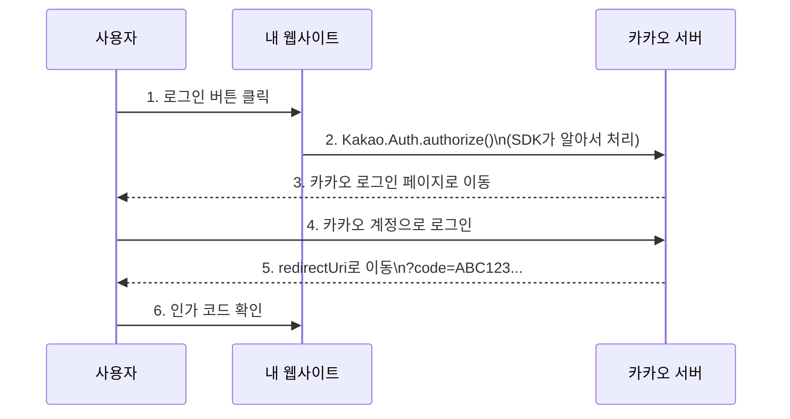

## 1. SDK의 등장 배경

SDK는 특정 시점에 갑자기 등장한 게 아니라, 소프트웨어 개발 환경이 복잡해지면서 자연스럽게 발전해온 개념!

### 왜 필요해졌나?

- 소프트웨어와 하드웨어가 복잡해지면서, 플랫폼 별로 필요한 도구(컴파일러, 라이브러리, 문서 등)가 흩어져 있었음.
- 플랫폼 사업자 입장에서는 외부 개발자를 끌어들여 생태계를 키우려면, 개발에 필요한 도구를 한 번에 제공하는 게 효율적이었음.

### 어떻게 발전해왔나?

| 시기 | 주요 변화 | SDK 형태 |
| --- | --- | --- |
| **1970~90년대** | PC/OS 확산 | 컴파일러, 디버거, 헤더/라이브러리를 CD로 배포 (Windows SDK 등) |
| **1990~2000년대** | 언어/플랫폼 정착 | JDK(Java), .NET SDK 등 언어별 개발 키트 |
| **2000년대 후반~** | 모바일/앱스토어 | iOS SDK, Android SDK - IDE, 에뮬레이터, UI 컴포넌트 통합 |
| **2010년대~현재** | 클라우드/SaaS | AWS SDK, Firebase SDK, 카카오 SDK - API 연동을 쉽게 해주는 클라이언트 라이브러리 |

지금 우리가 주로 사용하는 SDK(카카오, 토스페이먼츠, Firebase 등)는 클라우드/서비스 SDK 형태로, 외부 API를 쉽고 안전하게 사용할 수 있도록 인증, 에러처리나 타입 정의 등을 제공함.

---

## 2. SDK란 무엇인가?

### SDK는 “그냥 기능 묶음”이 아니다!

SDK는 그냥 기능 여러개를 묶어놓은 라이브러리라기 보다는, 그 플랫폼/서비스를 쓰는 데 필요한 것들을 한 번에 모아놓은 개발용 스타터팩에 가까움.

- AWS 공식 문서에서의 SDK설명:
    
    > "SDK는 개발자를 위한 플랫폼별 빌드 도구 세트입니다. 소프트웨어를 개발하고 실행하는 데 필요한 모든 것을 한 곳에 모아둡니다."
    — [출처](https://aws.amazon.com/ko/what-is/sdk/)
    > 
- GitHub 공식 문서에서의 SDK설명:
    
    > "SDK는 특정 플랫폼에서 소프트웨어 애플리케이션을 만들 수 있게 해주는 도구, 라이브러리, 문서, 코드 샘플, 프로세스, 가이드의 모음이다."
    — [출처](https://github.com/resources/articles/what-is-an-sdk)
    > 

### 단순 라이브러리 vs SDK

#### 단순 기능 묶음(라이브러리)

- 예시
    - Lodash, dayjs
- 목적
    - 언어 자체의 불편한 부분을 편하게 쓰게 해주는 유틸 함수 모음

```jsx
// Lodash - 배열/객체 처리를 편하게(범용 유틸리티)
import _ from 'lodash';

const users = [
  { name: 'Alice', age: 25 },
  { name: 'Bob', age: 30 }
];
const names = _.map(users, 'name'); // ['Alice', 'Bob']

// dayjs - 날짜 처리를 편하게
import dayjs from 'dayjs';
const date = dayjs().format('YYYY-MM-DD');
```

- 특징
    - 범용적인 기능
    - “이 서비스와 통신한다”는 맥락이 없음
    - 그냥 편리한 함수들

#### SDK(개발용 스타터팩)

- 예시
    - AWS SDK, Kakao SDK, Firebase SDK
- 목적
    - “AWS를 쓰게 한다.” “카카오 로그인을 붙이게 한다” 처럼 특정 플랫폼/서비스와 통합하는 것이 목표

```jsx
// AWS SDK - AWS 서비스를 쓰기 위한 도구
const AWS = require('aws-sdk');
const s3 = new AWS.S3();

await s3.putObject({
  Bucket: 'my-bucket',
  Key: 'file.txt',
  Body: 'content'
}).promise();
```

- SDK가 제공하는 것
    - 서비스용 클라이언트 라이브러리
    - 인증·에러 처리·재시도 로직
    - 설정/초기화 패턴
    - 공식 문서·가이드·샘플 코드

⇒ 즉, SDK는 “기능이 모여 있다” 보다 “이 서비스를 쓸 준비를 다 갖춘 도구 세트”라는 표현이 더 정확함.

### SDK가 하는 일: 복잡한 과정을 대신 처리해준다!

SDK의 핵심 역할은 복잡한 과정을 숨기고, 개발자가 쉽게 쓸 수 있게 만드는 것.

### 구체적인 예시로 이해해보기

#### AWS S3를 쓴다고 해보자

> **참고**: 
S3 SDK는 주로 **서버(Node.js, Lambda)에서 파일을 업로드/다운로드**할 때 사용. 브라우저에서 직접 S3에 업로드할 때는 보통 **Presigned URL** 방식을 쓰고, SDK는 그 URL을 생성하는 데 사용.
> 
- SDK 없이 쓰면
    - HTTP 요청 직접 만들고
    - AWS 인증용 서명을 계산하고 (복잡한 암호화 과정)
    - 헤더·쿼리 스트링 규칙 다 맞추고
    - 에러가 나면 재시도하는 코드도 직접 짜야 함.

```jsx
// SDK 없이 AWS S3 사용 (일부만 발췌)
// 실제로 이렇게 직접 구현하는 경우는 거의 없음
const crypto = require('crypto');

// 1. AWS 서명 계산 (복잡함)
function calculateSignature(stringToSign, signingKey) {
  return crypto.createHmac('sha256', signingKey)
    .update(stringToSign)
    .digest('hex');
}

// 2. 날짜/시간을 특정 형식으로 변환
const now = new Date();
const dateStamp = now.toISOString().split('T')[0].replace(/-/g, '');
const amzDate = now.toISOString().replace(/[:-]|\.\d{3}/g, '');

// 3. Canonical Request 생성 (AWS 규칙에 맞게)
const canonicalRequest = [
  'PUT',
  '/my-bucket/file.txt',
  '',
  'host:s3.amazonaws.com',
  'x-amz-date:' + amzDate,
  // ... 더 많은 복잡한 과정이 이어짐
].join('\n');

// 4. 서명 키 생성 (4단계나 거쳐야 함)
const kDate = crypto.createHmac('sha256', 'AWS4' + secretAccessKey)
  .update(dateStamp).digest();
// ... 계속 복잡한 과정
```

- AWS SDK 있으면
    - `PutObjectCommand`를 만들고 `client.send()`로 보내면, 인증, 서명, HTTP 요청, 재시도, 에러 처리를 SDK가 알아서 해줌

```jsx
// AWS SDK v3 공식 문서 예제
import { S3Client, PutObjectCommand } from "@aws-sdk/client-s3";

const client = new S3Client({ region: "ap-northeast-2" });

const command = new PutObjectCommand({
  Bucket: "my-bucket",
  Key: "file.txt",
  Body: "content",
});

await client.send(command);
```

> **참고**: 
위 코드는 AWS SDK v3 (최신) 문법. v2에서는 `new AWS.S3().putObject().promise()` 형태였지만, v3에서는 Command 패턴을 사용
— [AWS SDK v3 공식 문서 예제](https://docs.aws.amazon.com/sdk-for-javascript/v3/developer-guide/javascript_s3_code_examples.html)
> 

⇒ 이게 바로 “S3라는 서비스를 쉽게 쓰게 해주는 개발 도구 세트”라는 말의 구체적인 의미!

#### 카카오 로그인도 마찬가지

SDK없이 OAuth를 직접 구현하면 인증 URL 생성, 리다이렉트 처리, 토큰 요청 등을 모두 직접 해야함.

SDK를 쓰면 `akao.Auth.authorize()` 한 줄로 끝.

자세한 내용은 4번 실제 SDK 사용해보기에서 살펴보도록 할 예정..!

### 정리

"기능 묶음"보다, "특정 서비스를 쓸 준비를 다 해둔 도구 상자"라는 표현이 SDK에 더 맞음.

- 토스페이먼츠 공식 문서에서의 SDK설명:
    
    > "SDK(Software Development Kit)는 애플리케이션 개발 도구에요. 다른 회사에서 구현한 기능을 바로 내 애플리케이션에 사용할 수 있게 해줘요."
    — [출처](https://docs.tosspayments.com/resources/glossary/sdk)
    > 

---

## 3. SDK의 구성 요소

*토스페이먼츠 공식 문서를 참고해서 적음.

### SDK의 구성 요소 크게 4가지

| 구성 요소 | 설명 |
| --- | --- |
| **라이브러리** | 개발에 사용할 수 있는 클래스, 함수, 데이터가 정의된 코드 |
| **API** | 서비스와 통신하는 방법을 정의한 인터페이스 |
| **IDE** | 코드 에디터 (예: Xcode, Android Studio) - 일부 SDK에 포함 |
| **문서** | SDK를 어떻게 사용하는지 알려주는 가이드 |

### SDK vs API vs 라이브러리

이 3가지는 자주 혼동되는 개념!

| 개념 | 역할 | 범위 |
| --- | --- | --- |
| **API** | 두 소프트웨어가 통신하는 규칙 | 좁음 |
| **라이브러리** | 특정 기능을 수행하는 코드 모음 | 중간 |
| **SDK** | API + 라이브러리 + 문서 + 도구 | 넓음 |
- 토스페이먼츠 공식 문서에서의 3가지 비교 설명:
    
    > "API의 용도는 SDK의 용도보다 좁아요. SDK는 애플리케이션 개발을 돕는 개발 도구에요. 반면, API는 두 소프트웨어 프로그램이 통신하는 인터페이스에요."
    > 
    
    > "SDK에는 보통 API가 포함되어 있지만, API에는 SDK가 포함되지 않습니다."
    > 
- AWS 공식 문서에서의 설명:
    
    > "SDK는 지원하는 플랫폼을 위해 다른 여러 리소스와 함께 API를 포함할 수 있습니다."
    — [출처](https://aws.amazon.com/ko/compare/the-difference-between-sdk-and-api/)
    > 

---

## 4. 실제 SDK 예시를 알아보기:
카카오 JavaScript SDK

### 왜 카카오 SDK를?

- 한국에서 많이 사용되는 소셜 로그인
- 공식 문서가 한국어로 잘 정리되어 있음
- 복잡한 과정을 대신 처리해주는 것을 잘 보여주는 예시
- 카카오 공식 문서:
    
    > "카카오디벨로퍼스에서 제공하는 JavaScript SDK 사용 방법을 안내합니다."
    — [출처](https://developers.kakao.com/docs/latest/ko/javascript/getting-started)
    > 

### SDK 없이 vs SDK 사용 비교

#### SDK 없이 OAuth 직접 구현하면

- 복잡함.
- URL 파라미터 조합, 인코딩, fetch 요청 등을 직접 해야 함.

```jsx
// SDK 없이 카카오 로그인 (일부)
// 1. 인증 페이지로 이동 - URL을 직접 조합해야 함
const params = new URLSearchParams({
  client_id: 'YOUR_CLIENT_ID',
  redirect_uri: 'https://myapp.com/callback',
  response_type: 'code'
});
window.location.href = `https://kauth.kakao.com/oauth/authorize?${params}`;

// 2. 리다이렉트 후 code 추출
const code = new URLSearchParams(window.location.search).get('code');

// 3. Access Token 요청 (보통 서버에서 처리)
const tokenResponse = await fetch('https://kauth.kakao.com/oauth/token', {
  method: 'POST',
  headers: { 'Content-Type': 'application/x-www-form-urlencoded' },
  body: new URLSearchParams({
    grant_type: 'authorization_code',
    client_id: 'YOUR_CLIENT_ID',
    redirect_uri: 'https://myapp.com/callback',
    code: code
  })
});

const { access_token } = await tokenResponse.json();
// ... 토큰 저장, 사용자 정보 조회 등 계속
```

#### SDK 쓰면

- `Kakao.init()`, `Kakao.Auth.authorize()` 호출만으로 카카오 로그인 요청 과정을 SDK가 대신 처리해줌.
    
    (`Kakao.Auth.authorize()` 한 줄로 인증 URL 생성과 리다이렉트를 SDK가 알아서 처리)
    
- 인가 코드를 받은 후 토큰 발급은 서버에서 REST API로 처리함.

```jsx
// 카카오 공식 문서 예제 코드
// 1. SDK 초기화
Kakao.init('JAVASCRIPT_KEY');

// 2. 로그인 요청 - 이 한 줄이 위의 모든 과정을 대신함
Kakao.Auth.authorize({
  redirectUri: 'https://myapp.com/oauth/callback'
});
```

> [카카오 공식 문서 예제 코드](https://developers.kakao.com/docs/latest/ko/kakaologin/js)
> 

### 직접 간단히 해보기

#### SDK를 사용해서 실제로 카카오 로그인을 구현해보기

- index.html (로그인 페이지)
    
    ```jsx
    <!DOCTYPE html>
    <html lang="ko">
    <head>
        <meta charset="UTF-8" />
        <title>Kakao Login Demo</title>
        <!-- 1단계: SDK 로드 -->
        <script
            src="https://t1.kakaocdn.net/kakao_js_sdk/2.7.7/kakao.min.js"
            integrity="sha384-tJkjbtDbvoxO+diRuDtwRO9JXR7pjWnfjfRn5ePUpl7e7RJCxKCwwnfqUAdXh53p"
            crossorigin="anonymous"
        ></script>
    </head>
    <body>
        <h1>카카오 로그인 데모</h1>
    
        <a href="javascript:loginWithKakao()">
            
        </a>
    
        <script>
            // 2단계: SDK 초기화
            Kakao.init('JavaScript 키');
    
            // 3단계: 로그인 함수
            function loginWithKakao() {
                Kakao.Auth.authorize({
                    redirectUri: 'http://localhost:5500/kakao-callback.html',
                });
            }
        </script>
    </body>
    </html>
    ```
    
- kakao-callback.html (로그인 후 돌아오는 페이지)
    
    ```jsx
    <!DOCTYPE html>
    <html lang="ko">
    <head>
        <meta charset="UTF-8" />
        <title>Kakao Callback</title>
    </head>
    <body>
        <h2>로그인 처리 결과</h2>
        <pre id="result"></pre>
    
        <script>
            // URL에서 인가 코드 추출
            const params = new URLSearchParams(window.location.search);
            const code = params.get('code');
    
            if (code) {
                document.getElementById('result').innerText =
                    '카카오 로그인 성공!\n\n인가 코드:\n' + code;
            } else {
                document.getElementById('result').innerText =
                    '인가 코드 없음 (로그인 실패)';
            }
        </script>
    </body>
    </html>
    ```
    

#### 이 코드가 실행되면 어떤 일이 일어나지?



1. 사용자가 로그인 버튼 클릭 → `loginWithKakao()` 함수 실행
2. `Kakao.Auth.authorize()` 호출 → SDK가 카카오 인증 서버 URL을 만들어서 이동시킴
    - 실제로는 `https://kauth.kakao.com/oauth/authorize?client_id=...&redirect_uri=...&response_type=code` 이런 복잡한 URL로 이동하는 건데, SDK가 알아서 만들어줌
3. 카카오 로그인 페이지 표시 → 사용자가 카카오 계정으로 로그인
4. 동의 화면에서 "동의하고 계속하기" 클릭
5. redirectUri로 돌아옴 → URL에 인가 코드가 붙어서 옴
    - 예: `http://localhost:5500/kakao-callback.html?code=ABC123...`
6. 인가 코드 확인 → 이 코드를 서버로 보내서 Access Token을 받을 수 있음

#### 내가 한 것 vs SDK가 한 것

| 내가 직접 한 것 | SDK가 대신 해준 것 |
| --- | --- |
| SDK 스크립트 로드 | 카카오 인증 서버 URL 생성 |
| `Kakao.init()` 호출 | OAuth 파라미터 조합 (client_id, response_type 등) |
| `Kakao.Auth.authorize()` 호출 | URL 인코딩 처리 |
| redirectUri 설정 | 브라우저를 카카오 로그인 페이지로 이동 |
| 콜백 페이지에서 code 파싱 | - |

#### 다음 단계(참고)

이 예제에서는 인가 코드까지만 받았음. 실제 서비스에서는 아래와 같은 과정을 진행하게 됨.

- 인가 코드를 서버로 전송
- 서버에서 카카오 API로 Access Token 요청 (REST API)
- Access Token으로 사용자 정보 조회
- 우리 서비스 회원가입/로그인 처리

#### SDK의 공통 패턴

대부분의 SDK는 비슷한 패턴을 따름.

> 💡
>
> 1. 로드 (Load) → script 태그 또는 npm으로 SDK 불러오기
> 2. 초기화 (Init) → 앱 키로 SDK 활성화
> 3. 사용 (Use) → 제공되는 함수 호출

| SDK 예시 | 로드 | 초기화 | 사용 |
| --- | --- | --- | --- |
| 카카오 | `<script src="kakao.min.js">` | `Kakao.init('KEY')` | `Kakao.Auth.authorize()` |
| Firebase | `<script src="firebase-app.js">` | `firebase.initializeApp(config)` | `firebase.auth()` |
| Google Maps | `<script src="maps.js">` | `new google.maps.Map()` | `map.setCenter()` |

---

## 5. SDK 배포 방식

SDK는 크게 두 가지 방식으로 배포됨.

### CDN 방식 (script 태그)

```html
<script src="https://t1.kakaocdn.net/kakao_js_sdk/2.7.4/kakao.min.js"></script>
```

- **장점**: 설치가 간편, 빌드 과정이 필요 없음
- **단점**: 버전을 직접 관리해야 함, 타입스크립트 지원이 제한적임
- **예시**: 카카오 SDK, Google Maps SDK

### **npm 방식 (패키지 설치)**

```bash
npm install firebase
```

```jsx
import { initializeApp } from 'firebase/app';
```

- **장점**: 버전 관리가 쉬움, 타입스크립트 지원이 잘 됨
- **단점**: 빌드 과정이 필요함
- **예시**: Firebase SDK, AWS SDK

---

## 6. 미니 Analytics SDK 만들어보기

"특정 서비스를 쓸 준비를 다 해둔 도구 상자"를 직접 만들어봅시당

### 목표

- SDK의 공통 패턴 (로드 → 초기화 → 사용) 직접 구현하기
- 복잡한 과정을 숨기고 쉬운 함수만 제공하는 원리 이해하기
- 개발자는 간딘하게 메서드만 호출하면 되게 만들기

### 우리가 만들 SDK의 사용법

```jsx
// 1. 초기화
MiniAnalytics.init({ appId: 'my-app', debug: true });

// 2. 초기화 확인
MiniAnalytics.isInitialized(); // true

// 3. 이벤트 추적 - 개발자는 이것만 호출
MiniAnalytics.track('button_click', { buttonId: 'signup' });

// 4. 수집된 데이터 확인
MiniAnalytics.getEvents();
```

### SDK 구현 코드 (mini-analytics-sdk.js)

#### 코드

```jsx
const MiniAnalytics = {
    // 설정 저장
    config: {
        appId: null,
        debug: false,
    },

    // 이벤트 저장 배열
    eventQueue: [],

    // 초기화 함수
    init(options) {
        if (!options?.appId) {
        console.error('[MiniAnalytics] appId는 필수입니다');
        return;
        }

        this.config.appId = options.appId;
        this.config.debug = options.debug || false;

        if (this.config.debug) {
        console.log('[MiniAnalytics] 초기화 완료:', this.config.appId);
        }

        // 페이지 방문 이벤트 자동 기록
        this.track('pageview', {
        url: window.location.href,
        title: document.title,
        });

        return this;
    },

    // 초기화 여부 확인
    isInitialized() {
        return this.config.appId !== null;
    },

    // 이벤트 추적
    track(eventName, eventData = {}) {
        if (!this.isInitialized()) {
        console.error('[MiniAnalytics] init()을 먼저 호출하세요');
        return this;
        }

        // SDK가 자동으로 추가하는 정보들
        const event = {
        appId: this.config.appId,
        eventName,
        eventData,
        timestamp: new Date().toISOString(),
        userAgent: navigator.userAgent,
        screenSize: `${screen.width}x${screen.height}`,
        };

        this.eventQueue.push(event);

        if (this.config.debug) {
        console.log('[MiniAnalytics] 이벤트 기록:', eventName, eventData);
        }

        return this;
    },

    // 수집된 이벤트 조회
    getEvents() {
        return [...this.eventQueue];
    },
};

// 전역 객체로 노출
window.MiniAnalytics = MiniAnalytics;
```

#### 코드 해설

- 전체 구조
    
    ```jsx
    const MiniAnalytics = {
      config: { ... },         // 설정 저장소
      eventQueue: [],          // 이벤트 저장소
      init() { ... },          // 초기화 함수
      isInitialized() { ... }, // 초기화 확인 함수
      track() { ... },         // 이벤트 추적 함수
      getEvents() { ... },     // 이벤트 조회 함수
    };
    ```
    
    - MiniAnalytics는 하나의 객체고, 그 안에 설정, 데이터, 함수들이 다 들어있음.
- config - 설정 저장소
    
    
    | 속성 | 역할 | 기본값 |
    | --- | --- | --- |
    | `appId` | 이 SDK를 사용하는 앱의 고유 ID | `null` (초기화 전) |
    | `debug` | `true`면 콘솔에 로그 출력 | `false` |
- eventQueue - 이벤트 저장소
    - `track()`으로 기록한 이벤트들이 이 배열에 쌓임. 실제 SDK라면 이걸 서버로 전송하겠지만, 우리는 저장만…!
- init() - 초기화 함수
    
    ```jsx
    init(options) {
      // 1) appId 없으면 에러
      if (!options?.appId) {
        console.error('[MiniAnalytics] appId는 필수입니다');
        return;
      }
    
      // 2) 설정 저장
      this.config.appId = options.appId;
      this.config.debug = options.debug || false;
    
      // 3) 디버그 모드면 로그 출력
      if (this.config.debug) {
        console.log('[MiniAnalytics] 초기화 완료:', this.config.appId);
      }
    
      // 4) 페이지 방문 이벤트 자동 기록
      this.track('pageview', {
        url: window.location.href,
        title: document.title,
      });
    
      return this;
    },
    ```
    
    1. `appId` 없으면 에러 출력하고 종료
    2. 전달받은 설정을 `this.config`에 저장
    3. debug 모드면 "초기화 완료" 로그 출력
    4. 자동으로 pageview 이벤트 기록 ← 개발자가 안 해도 SDK가 알아서!
- isInitialized() - 초기화 확인 함수
    - `appId`가 있으면 초기화된 것, 없으면(`null`) 아직 안 된 것
- track() - 이벤트 추적 함수
    
    ```jsx
    track(eventName, eventData = {}) {
      // 1) 초기화 안 됐으면 에러
      if (!this.isInitialized()) {
        console.error('[MiniAnalytics] init()을 먼저 호출하세요');
        return this;
      }
    
      // 2) 이벤트 객체 생성 - SDK가 자동으로 정보 추가
      const event = {
        appId: this.config.appId,
        eventName,
        eventData,
        timestamp: new Date().toISOString(),
        userAgent: navigator.userAgent,
        screenSize: `${screen.width}x${screen.height}`,
      };
    
      // 3) 배열에 저장
      this.eventQueue.push(event);
    
      // 4) 디버그 모드면 로그 출력
      if (this.config.debug) {
        console.log('[MiniAnalytics] 이벤트 기록:', eventName, eventData);
      }
    
      return this;
    },
    ```
    
    > **참고: userAgent, screenSize는 어디서 오는 걸까?**
    > 
    > 
    > 브라우저가 기본으로 제공하는 전역 객체에서 가져옴. 
    > 
    - 개발자가 이렇게만 호출하면
        
        ```jsx
        MiniAnalytics.track('button_click', { buttonId: 'signup' });
        ```
        
    - SDK가 내부에서 이런 객체를 만들어서 저장함.
        
        ```jsx
        {
          appId: 'my-app',
          eventName: 'button_click',
          eventData: { buttonId: 'signup' },
          timestamp: '2026-01-02T14:30:00.000Z',  // ← SDK가 자동 추가
          userAgent: 'Mozilla/5.0...',             // ← SDK가 자동 추가
          screenSize: '1920x1080',                 // ← SDK가 자동 추가
        }
        ```
        
        개발자는 2개만 전달 → SDK는 6개 정보를 만들어냄!
        
- getEvents() - 이벤트 조회 함수
    - 저장된 이벤트 배열을 복사해서 반환함.
- window.MiniAnalytics - 전역 객체로 노출
    - `window`에 붙여야 HTML에서 `MiniAnalytics.init()` 이렇게 쓸 수 있음. 안 붙이면 이 파일 안에서만 쓸 수 있다….!

### 데모 페이지 (demo.html)

```jsx
<!DOCTYPE html>
<html>
<head>
    <meta charset="UTF-8">
    <title>Mini Analytics SDK Demo</title>
    </head>
    <body>
    <h1>Mini Analytics SDK Demo</h1>
    
    <button id="signupBtn">회원가입</button>
    <button id="purchaseBtn">구매하기</button>
    <button id="showEventsBtn">수집된 이벤트 보기</button>

    <!-- SDK 로드 -->
    <script src="mini-analytics-sdk.js"></script>
    
    <script>
        // 1. 초기화
        MiniAnalytics.init({
	        appId: 'my-app-001',
	        debug: true,
        });

        // 2. 초기화 확인
        console.log('초기화 상태:', MiniAnalytics.isInitialized());

        // 3. 이벤트 추적
        document.getElementById('signupBtn').addEventListener('click', () => {
        MiniAnalytics.track('button_click', {
            buttonId: 'signupBtn',
            buttonText: '회원가입',
        });
        });

        document.getElementById('purchaseBtn').addEventListener('click', () => {
        MiniAnalytics.track('purchase', {
            productId: 'PROD-001',
            price: 25000,
        });
        });

        // 4. 수집된 데이터 확인
        document.getElementById('showEventsBtn').addEventListener('click', () => {
        console.log('수집된 이벤트:', MiniAnalytics.getEvents());
        });
    </script>
</body>
</html>
```

### 실습 순서 및 콘솔에서 확인할 수 있는 것

1. `mini-analytics-sdk.js` 파일 생성
2. `demo.html` 파일 생성 (같은 위치)
3. 브라우저에서 `demo.html` 열기
4. 개발자 도구 콘솔 열기 (F12)
5. 버튼 클릭하고 콘솔에서 로그 확인
6. 수집된 이벤트 보기 버튼 클릭해서 전체 데이터 확인


페이지진입 - 회원가입 - 구매하기 2번 - 수집된 이벤트 보기

### 우리 SDK가 대신 처리해주는 것들

#### 개발자가 하는 일

```jsx
MiniAnalytics.track('button_click', { buttonId: 'signup' });
```

#### SDK가 내부에서 알아서 처리하는 일

- 초기화 확인
- 이벤트 객체 생성
- 타임스탬프 자동 추가
- 브라우저 정보 자동 수집
- (실제라면) API 주소 결정
- (실제라면) HTTP 요청 전송
- (실제라면) 에러 처리 및 재시도

⇒ 개발자는 "어떤 이벤트인지"만 알려주면 되고, 나머지는 SDK가 알아서 처리함. 
이 서비스를 쓸 준비를 다 갖춘 도구 세트의 의미 확인!

---

## 7. 최종 정리

- SDK는 무엇인가?
    - "그냥 기능 묶음"이 아니라
    - "특정 서비스를 쓸 준비를 다 해둔 도구 상자"
    - 복잡한 과정을 대신 처리해서 개발자는 간단한 함수만 호출하면 됨
- SDK vs 라이브러리
    - 라이브러리(ex. Lodash): 어디서든 쓸 수 있는 범용 함수 모음
    - SDK(ex. Kakao SDK): 특정 서비스용 + 인증 처리 + 에러 처리 + 문서
- SDK의 공통 패턴
    - 로드 → 초기화 → 사용
    - 구체적인 예시
        - AWS S3: 수십 줄의 복잡한 서명 로직 → `client.send(new PutObjectCommand(...))` 몇 줄
        - 카카오 로그인: OAuth 인가 코드 요청 과정 → `Kakao.Auth.authorize()` 한 줄
